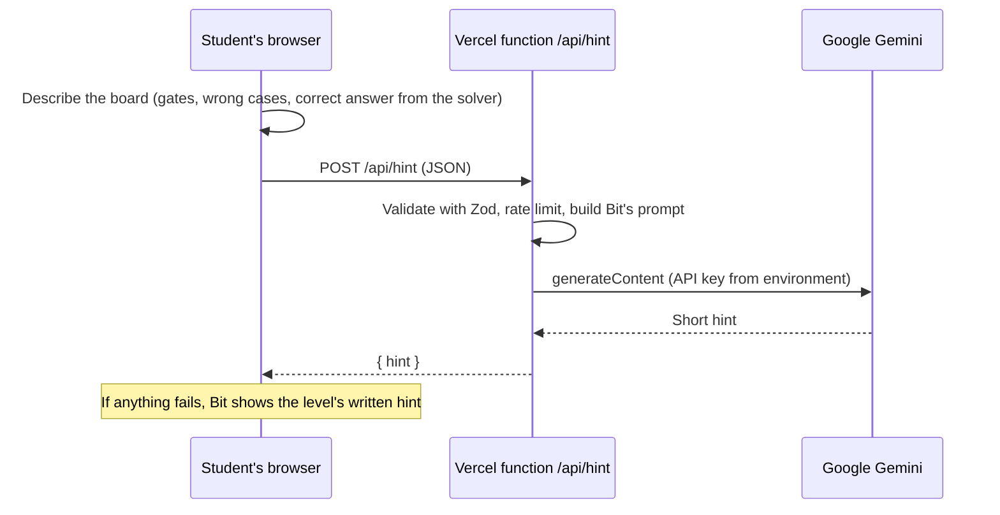
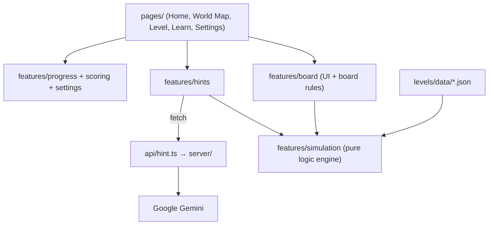

# Architecture

## How a hint request works

## Layers

## Design decisions

| Decision                                | Why                                                                     |
| --------------------------------------- | ----------------------------------------------------------------------- |
| Logic engine has no React code          | Easy to unit test, and the same code checks levels, hints and the board |
| Levels are JSON data, validated by Zod  | New levels need no code changes; mistakes are caught by tests           |
| A solver proves every level is solvable | No impossible levels; the AI hint also knows the correct answer         |
| AI key only on the server               | Students can't see or misuse it                                         |
| Written fallback hint for every level   | The game works without internet or an API key                           |
| Progress in localStorage, no accounts   | No personal data collected from students under 18                       |
| Power only shown after "Test circuit"   | Students must think before seeing the answer                            |
